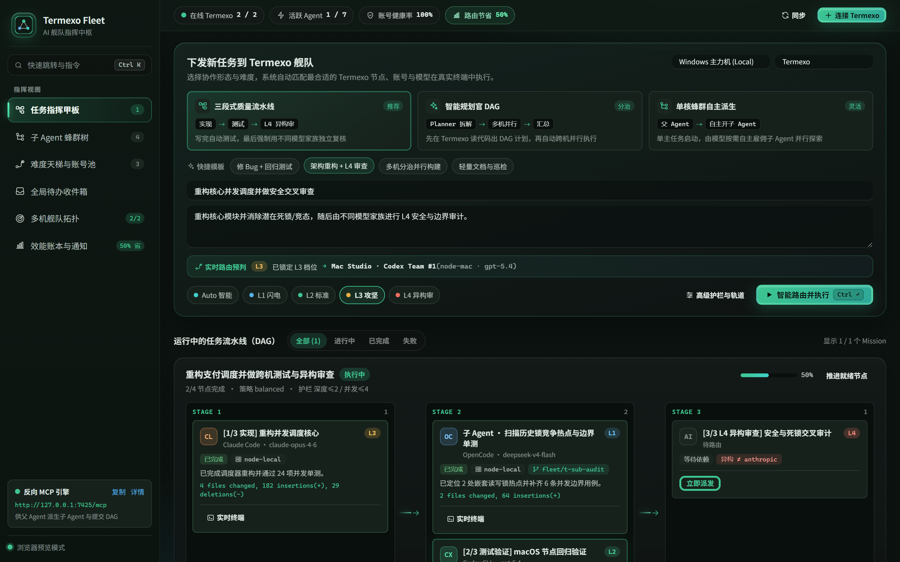
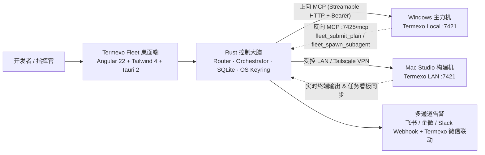
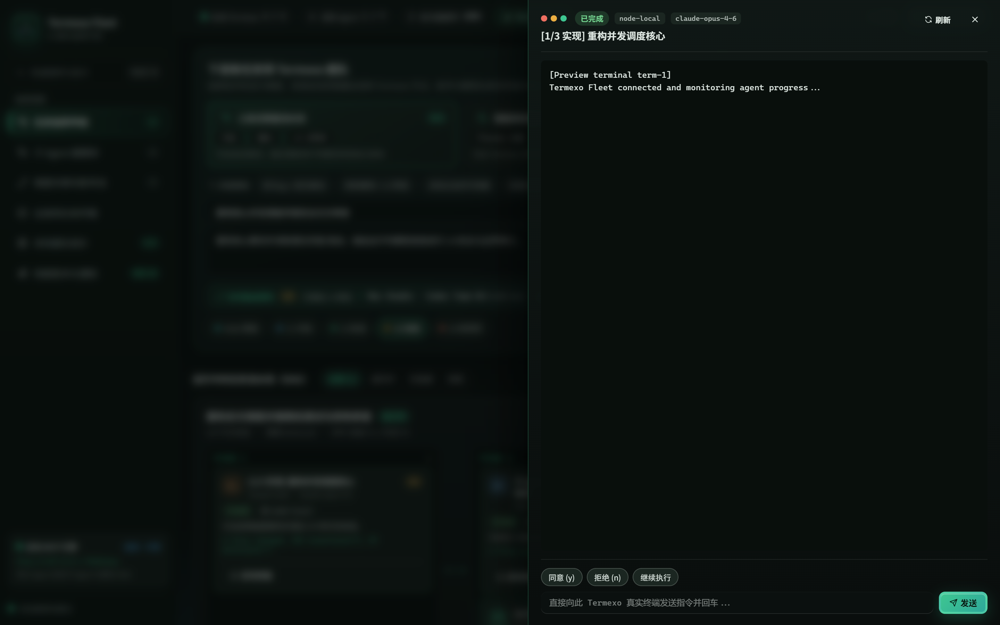
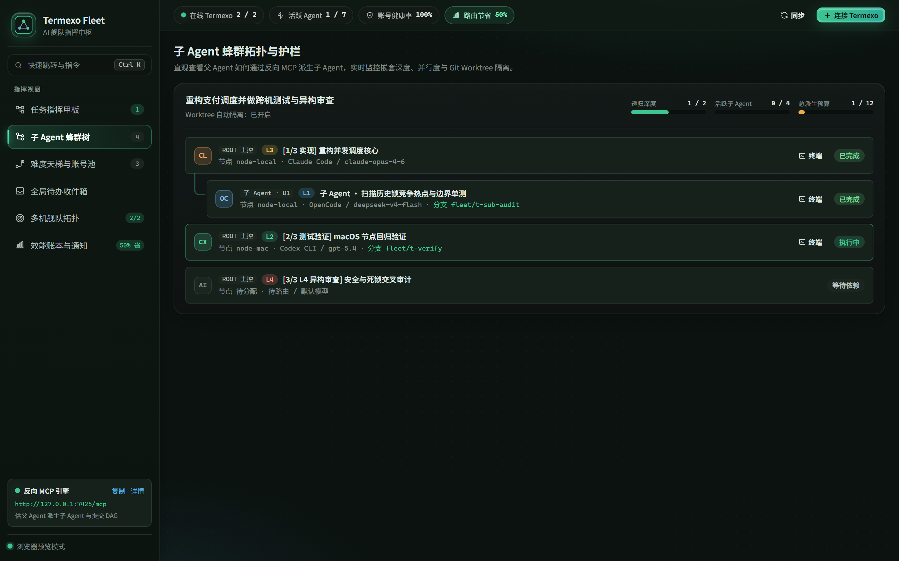
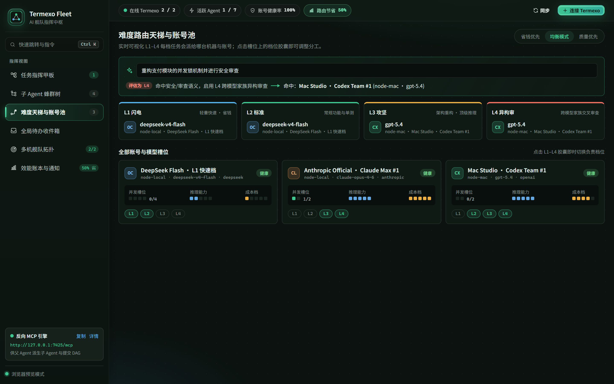
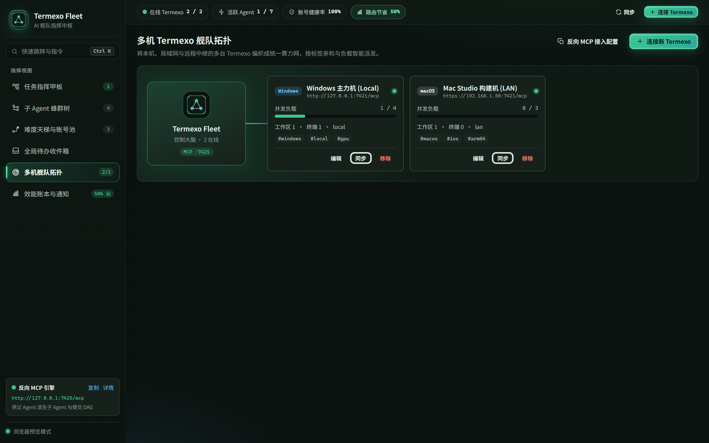
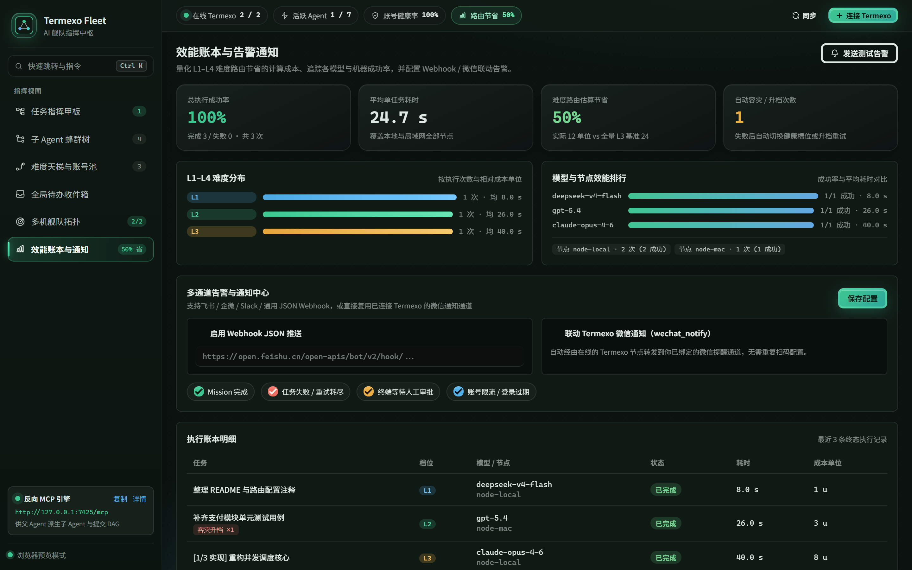
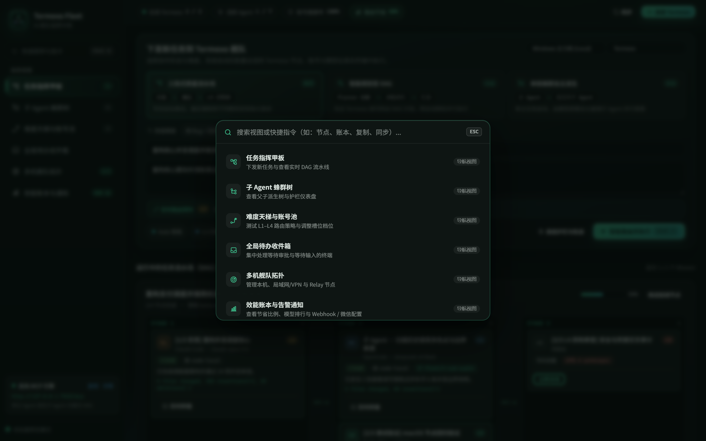

<p align="center">
  
</p>

<h1 align="center">Termexo Fleet</h1>

<p align="center"><strong>本地优先的 AI 编程舰队指挥中枢 · 统一编排多台 Termexo</strong></p>

<p align="center">
  <a href="./README.md">English</a> · <strong>简体中文</strong>
</p>

<p align="center">
  <a href="https://github.com/gemron/Termexo-Fleet/releases/tag/v0.1.0-preview.1"></a>
  
  
  
  
  
</p>

<p align="center">
  <a href="https://www.termexo.com/#fleet">官网展示页</a> ·
  <a href="https://github.com/gemron/Termexo-Fleet/releases/tag/v0.1.0-preview.1">下载预览版</a> ·
  <a href="./docs/preview/PREVIEW.md">完整预览手册</a> ·
  <a href="https://github.com/gemron/Termexo">Termexo 工作台</a>
</p>

---

**将单台或多台 [Termexo](https://github.com/gemron/Termexo) 桌面端编织为统一、零黑盒的 AI 研发舰队。**

在指挥甲板输入一句自然语言需求，**Termexo Fleet** 会自动评估任务难度（`L1–L4`），在已连接的本机与局域网/VPN Termexo 节点间挑选最合适的机器、账号与模型；支持父 Agent 通过反向 MCP 自主拆解并行 DAG 或在独立 Git Worktree 中派生子 Agent；遇到限流或报错自动冷却切号与升档重试，并用本地 SQLite 效能账本量化每一次路由节省的成本——同时**所有执行全程透明落地于 Termexo 真实终端与任务看板**，随时可旁观或一键接管。

[](./docs/preview/PREVIEW.md)

| 零黑盒透明执行 | 难度感知 `L1–L4` 智能路由 | 自主子 Agent 蜂群 + 安全护栏 |
| --- | --- | --- |
| 每个主任务与子 Agent 都运行在真实 Termexo PTY 终端与看板中，侧滑实时终端抽屉随时查看输出并直接回复。 | 轻量改动走省钱快模型（`L1`），常规功能走 `L2/L3`，关键代码 `L4` 强制跨模型家族异构交叉审查。 | 内置反向 MCP 引擎（`:7425/mcp`），受深度、并发、总预算与 Git Worktree 隔离护栏约束，放手不失控。 |

---

## 解决什么问题

同时使用 Claude Code、Codex CLI、OpenCode、Pi Agent、Grok Build、Antigravity 以及多套账号/多台电脑时，常见四大痛点：

1. **杀鸡用牛刀，顶级额度烧得快**：改文案、补注释、写简单单测也全部交给最贵模型，成本与限流压力居高不下。
2. **限流与异常需要人工盯着切号**：遇到 `429 限流`、`402 余额不足`、`422 模型不可用` 或登录过期，任务直接停摆。
3. **单一模型自写自审存在盲区**：同一个模型家族既写并发/安全核心又做审查，容易遗漏同源逻辑漏洞。
4. **传统多 Agent 框架全是黑盒**：隐藏 API 循环无法实时看到终端执行细节，卡在工具审批或需要中途纠偏时极难介入。

**Termexo Fleet** 以 Termexo 作为公开透明的执行底座，在其之上构建 Rust 控制大脑，把「多机、多账号、按难度路由、自主子 Agent、可观测容灾」收拢进一个高颜值桌面指挥舱。

---

## L1–L4 难度天梯与成本量化

支持 `省钱优先 (cost)` / `均衡 (balanced)` / `质量优先 (quality)` 三种策略，下发前在输入框下方实时预判命中的机器与账号：

| 难度档位 | 典型适用任务 | 路由与容灾行为 | 相对成本单位 |
| :---: | --- | --- | :---: |
| **`L1` 闪电档** | 改文案、补注释、格式化、只读仓库巡检 | 优先命中低成本高速槽位（如 DeepSeek Flash / Haiku / Mini） | `1 u` |
| **`L2` 标准档** | 常规功能开发、Bug 修复、单元/集成测试 | 综合推理质量、成本与节点并发余量均衡派发 | `3 u` |
| **`L3` 攻坚档** | 架构重构、并发死锁排查、数据库迁移 | 优先分配顶级推理模型槽位（如 Claude Opus / GPT-5.4） | `8 u` |
| **`L4` 异构审** | 安全审计、核心 Diff 复核、发布门禁 | **自动识别并排除上游作者的模型家族**（如 Claude 实现 → Codex 审查） | `8 u` |

- **自愈容灾与自动升档**：实时识别终端中的 `429 RateLimited`、`402/422 ApiError`、`AuthExpired` 与 `WaitingApproval`；异常槽位自动进入 5 分钟冷却，任务自动切换到其他健康账号/节点，并在失败重试时自动升档（`L1 → L2 → L3`）。

---

## 自主子 Agent 与反向 MCP 引擎（`127.0.0.1:7425/mcp`）

Fleet 内置受 Bearer 令牌保护的 Streamable HTTP 反向 MCP 服务。通过 Termexo 任务级 `mcpProfileIds` 按需注入后，运行在 Termexo 终端内的父 Agent 可自主调用 7 个编排工具：

| 反向 MCP 工具 | 能力说明 | 工程护栏与约束 |
| --- | --- | --- |
| `fleet_list_nodes` | 查询当前在线 Termexo 节点、系统标签、工作区与算力余量 | 校验任务级 `parent_token` |
| `fleet_submit_plan` | Planner 提交多阶段 DAG 计划（依赖关系、节点标签、`L1–L4`） | 执行 Kahn 环路检测，自动解锁首阶段并行节点 |
| `fleet_spawn_subagent` | 父 Agent 按需雇佣子 Agent 处理拆分出的子目标 | 强制校验最大深度、最大并发、总派生上限、重复目标去重及 Git Worktree 自动隔离 |
| `fleet_list_subagents` | 查看当前父任务名下所有子 Agent 的状态、节点、分支与模型 | 仅限当前父任务作用域 |
| `fleet_wait_subagents` | 等待指定子 Agent 完成并回收结果摘要 | 带超时保护，自动汇总 `resultSummary` 与 `git diff --stat` |
| `fleet_message_subagent` | 向运行中的子 Agent 终端追加或修正指令 | 写入对应 Termexo 真实 PTY 终端 |
| `fleet_cancel_subagent` | 中止失控或不再需要的子 Agent | 停止远端任务并立即释放槽位并发 |

---

## 典型使用场景

| 使用场景 | 推荐编排形态 | 实际收益 |
| --- | --- | --- |
| **日常研发智能省钱** | 自动难度评估（`均衡` / `省钱优先`） | 小任务自动走 `L1/L2` 低成本槽位，难题走 `L3`，效能账本实时测算节省 40%–60% 算力成本。 |
| **核心代码质量闭环** | 三段式质量流水线（`实现 → 测试 → L4 异构审`） | 写完自动跑单测，最后强制由不同模型家族带着上游摘要和 `diff --stat` 交叉审计。 |
| **Windows + Mac 跨机协同** | 智能规划官 DAG（`#windows` + `#macos` 标签） | 本机 Windows 与局域网/Tailscale Mac Studio 同时接入，后端与 macOS/iOS 构建并行推进。 |
| **长任务无人值守** | 自主蜂群 + Worktree 隔离 + 多通道告警 | 子 Agent 各自在独立 Worktree 分支并行不冲突；限流自动切号，等待审批或完工自动推送飞书 / 企微 / Slack / Termexo 微信通知。 |

---

## 系统架构



---

## 界面实机截图

完整图文预览与细节见 **[docs/preview/PREVIEW.md](./docs/preview/PREVIEW.md)**。

| 右侧滑出式实时终端抽屉（支持刷新与直接对话） | 子 Agent 蜂群树与安全护栏仪表盘 |
| :---: | :---: |
|  |  |

| `L1–L4` 难度路由天梯与实时模拟器 | 多机 Termexo 星型舰队拓扑 |
| :---: | :---: |
|  |  |

| 效能账本与多通道告警通知中心 | 全局命令面板（`Ctrl+K`） |
| :---: | :---: |
|  |  |

---

## 安全与本地优先原则

- **完全本地运行**：状态数据库（`termexo-fleet.db`）、执行账本与路由策略均保存在本机，无需注册任何云账号。
- **凭据交由系统钥匙串**：所有 Termexo 节点 Access Token 与 Fleet 反向 MCP Bearer Token 均存入 Windows 凭据管理器 / macOS 钥匙串 / Linux Secret Service，绝不落盘明文。
- **受控局域网互联**：Termexo 局域网 MCP 模式默认关闭（`allowLan: false`），开启后强制 Bearer 鉴权并仅放行 RFC1918 私网与 Tailscale (`100.64.0.0/10`) Host，防范 DNS Rebinding 与公网暴露。

---

## 快速开始

### 方式一：直接下载 Windows 预览安装包
前往 **[GitHub Releases (`v0.1.0-preview.1`)](https://github.com/gemron/Termexo-Fleet/releases/tag/v0.1.0-preview.1)** 下载：
- `Termexo.Fleet_0.1.0_x64-setup.exe`（NSIS 安装包，推荐）
- `Termexo.Fleet_0.1.0_x64_en-US.msi`（Windows MSI 安装包）

### 方式二：源码运行

```bash
# 安装前端依赖
npm --prefix apps/desktop-ui install

# 开发模式启动完整桌面应用
npm run tauri:dev

# 构建与测试
npm run build
npm test
scripts\cargo-msvc.cmd test --workspace --lib --bins   # Windows (MSVC)

# 打包 Windows 正式安装包 (.exe & .msi)
npm run tauri:build
```

### 三步连接第一台 Termexo
1. 在 **Termexo** 打开「设置 → AI 操控（MCP）」，开启本地服务并复制 Access Token。
2. 在 **Termexo Fleet** 点击右上角 **「+ 连接 Termexo」**，选择预设（本机 / 局域网 / Tailscale），点击 **「测试连通性」** 验证延迟与能力后保存。
3. *（可选）* 点击左侧栏 **「反向 MCP 引擎 → 复制」**，粘贴到 Termexo「设置 → MCP Profile」即可解锁 Planner DAG 与自主子 Agent 派生。

---

## 开源协议

MIT License · 与 [Termexo](https://github.com/gemron/Termexo) 一同开源共建。
