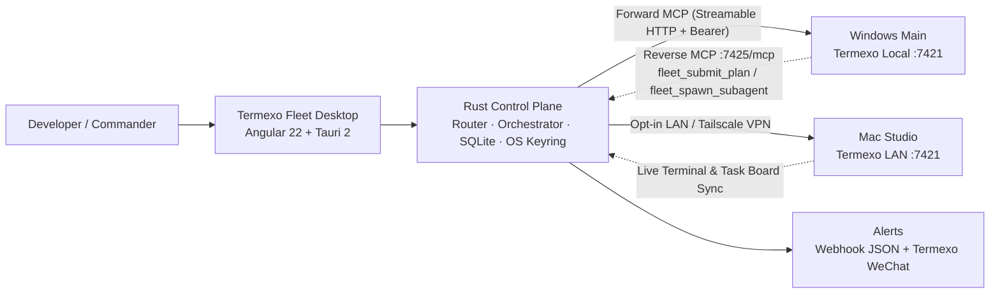

# Termexo Fleet

> **Local-first AI Coding Fleet Commander** · 本地优先的 AI 编程舰队指挥中枢

Orchestrate one or more **[Termexo](https://github.com/gemron/Termexo)** instances from a single desktop mission control — with difficulty-aware `L1–L4` account & model routing, autonomous sub-agent spawning via reverse MCP, multi-machine DAG pipelines, zero black-box execution, and cost/efficiency analytics.


---

## Core Capabilities

- **Zero Black-Box Execution** — Every mission, DAG step, and spawned sub-agent runs transparently inside real Termexo terminals (PTY) and task boards. Open the slide-over **Live Terminal Drawer** at any time to inspect output or send replies directly.
- **Difficulty-Aware Routing (`L1–L4`)** — Automatically evaluates tasks across `L1` (fast/low-cost), `L2` (standard dev/tests), `L3` (architecture/concurrency), and `L4` (cross-family heterogeneous review), with `cost` / `balanced` / `quality` strategies and a live routing forecast strip.
- **Self-Healing Failover & Escalation** — Detects `429` rate limits, `402` balance exhaustion, `422` invalid models, and expired logins from terminal output; cools down unhealthy slots, fails over across accounts/nodes, and escalates difficulty (`L1 → L2 → L3`) on retry.
- **Autonomous Sub-Agent Swarm + Guardrails** — Built-in Streamable HTTP reverse MCP engine (`127.0.0.1:7425/mcp`) exposes 7 orchestration tools (`fleet_list_nodes`, `fleet_submit_plan`, `fleet_spawn_subagent`, `fleet_list_subagents`, `fleet_wait_subagents`, `fleet_message_subagent`, `fleet_cancel_subagent`) with strict depth, concurrency, total budget, duplicate detection, and automatic **Git Worktree** branch isolation.
- **Multi-Machine Fleet Topology** — Connect local, LAN/Tailscale VPN (with private-network guard & optional self-signed TLS), and relay Termexo nodes; probe latency & capabilities before saving; route tasks by `#windows` / `#macos` / `#gpu` tag affinity.
- **Execution Ledger & Multi-Channel Alerts** — Local SQLite ledger tracks success rate, duration, escalations, and estimated savings vs. an all-`L3` baseline; dispatches deduplicated alerts to JSON Webhooks (Feishu / WeCom / Slack / custom) and Termexo's `wechat_notify` bridge.

---

## Architecture



### Workspace Layout
- `crates/fleet-protocol` — Shared domain models (`FleetNode`, `AccountModelSlot`, `Mission`, `MissionTask`, `ExecutionRecord`, `FleetAnalytics`, `NotificationSettings`)
- `crates/fleet-connector` — Streamable HTTP Termexo MCP client, capability auto-discovery, connectivity probe, terminal signal classifier
- `crates/fleet-router` — `L1–L4` difficulty evaluator, cross-node tag affinity & load-balanced slot router, L4 cross-family exclusion
- `crates/fleet-orchestrator` — DAG cycle validation & topological layering, sub-agent guardrails, Git Worktree lifecycle
- `crates/fleet-mcp-server` — Axum reverse MCP server with Bearer auth
- `src-tauri` — Tauri 2 desktop runtime, SQLite persistence, OS Keyring secret storage, webhook/WeChat dispatcher
- `apps/desktop-ui` — Angular 22 + Tailwind CSS 4 + DaisyUI 5 Mission Control UI (`Ctrl+K` Command Palette, Live Terminal Drawer, DAG Pipeline, Swarm Tree, Routing Ladder, Fleet Topology, Analytics & Alerts)

---

## Interface Gallery

See the full Chinese product preview & use cases in **[docs/preview/PREVIEW.md](./docs/preview/PREVIEW.md)**.

| Live Terminal Drawer | Swarm Tree & Guardrails |
| :---: | :---: |
|  |  |

| L1–L4 Routing Ladder & Account Pool | Multi-Machine Fleet Topology |
| :---: | :---: |
|  |  |

| Execution Ledger & Multi-Channel Alerts | Global Command Palette (`Ctrl+K`) |
| :---: | :---: |
|  |  |

---

## Quick Start

```bash
# Install frontend dependencies
npm --prefix apps/desktop-ui install

# Run full desktop app in dev mode
npm run tauri:dev

# Run checks & tests
npm run build
npm test
scripts\cargo-msvc.cmd test --workspace --lib --bins   # Windows (MSVC)

# Build Windows installers (.msi & NSIS .exe)
npm run tauri:build
```

1. Enable **AI Control (MCP)** in Termexo Settings and copy its Access Token.
2. Click **+ 连接 Termexo** in Termexo Fleet, pick a preset (Local / LAN / Tailscale), click **测试连通性**, and save.
3. *(Optional)* Copy the reverse MCP snippet from the sidebar **反向 MCP 引擎** card into Termexo **Settings → MCP Profile** to unlock autonomous Planner DAGs and sub-agent spawning.

---

## License

MIT
