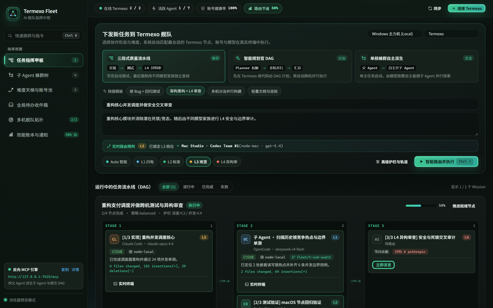
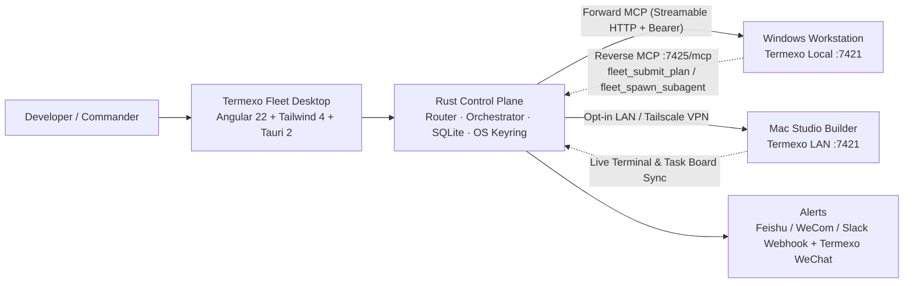
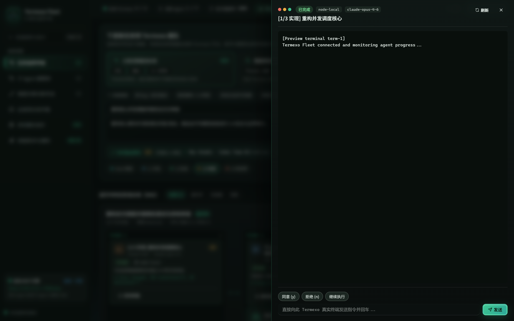
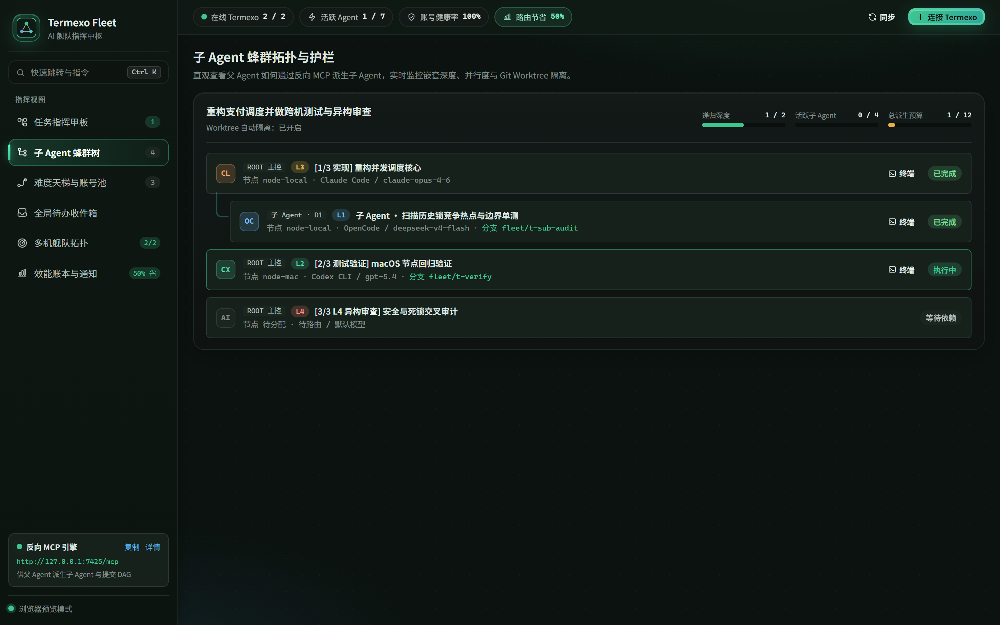
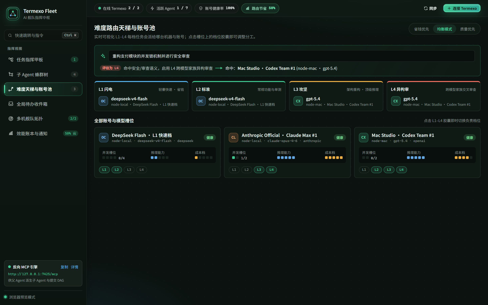
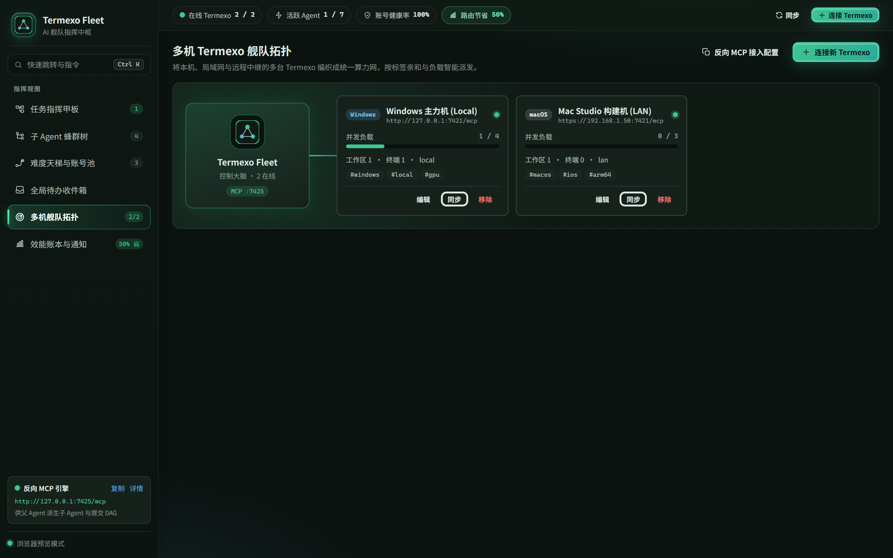
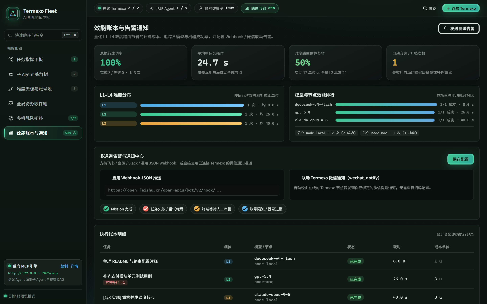
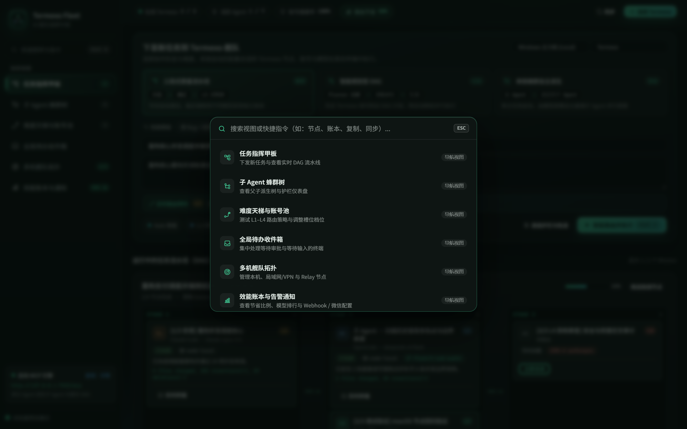

<p align="center">
  
</p>

<h1 align="center">Termexo Fleet</h1>

<p align="center"><strong>Local-first AI Coding Fleet Commander for Termexo</strong></p>

<p align="center">
  <strong>English</strong> · <a href="./README.cn.md">简体中文</a>
</p>

<p align="center">
  <a href="https://github.com/gemron/Termexo-Fleet/releases"></a>
  
  
  
  
  
</p>

<p align="center">
  <a href="https://www.termexo.com/#fleet">Website Showcase</a> ·
  <a href="https://github.com/gemron/Termexo-Fleet/releases">Downloads</a> ·
  <a href="./docs/preview/PREVIEW.md">Product Preview Dossier</a> ·
  <a href="https://github.com/gemron/Termexo">Termexo Workbench</a>
</p>

---

**Orchestrate one or more [Termexo](https://github.com/gemron/Termexo) desktops as a unified, zero-black-box AI engineering fleet.**

Describe a goal once. **Termexo Fleet** grades task complexity (`L1–L4`), picks the right machine, account, and model across your connected Termexo nodes, lets parent agents autonomously spawn isolated sub-agents in Git Worktrees, recovers automatically from rate limits or provider failures, and tracks cost savings in a local SQLite ledger — while every single agent runs visibly inside real Termexo terminals and task boards.

[](./docs/preview/PREVIEW.md)

| Zero Black-Box Execution | Difficulty-Aware `L1–L4` Routing | Autonomous Sub-Agent Swarm |
| --- | --- | --- |
| Every task and sub-agent runs inside a real Termexo PTY terminal & task board. Inspect live output or reply anytime from the slide-over drawer. | Match lightweight edits to fast low-cost models (`L1`), core features to `L2/L3`, and force cross-family heterogeneous audits on `L4`. | Built-in reverse MCP (`:7425/mcp`) lets agents submit parallel DAGs and spawn worktree-isolated child agents under strict guardrails. |

---

## Why Termexo Fleet?

Running multiple coding agents (Claude Code, Codex CLI, OpenCode, Pi Agent, Grok Build, Antigravity) across several accounts and machines quickly creates four operational bottlenecks:

1. **Overpaying on simple work** — Sending README tweaks or unit test scaffolding to flagship reasoning models burns top-tier quota unnecessarily.
2. **Manual failover & baby-sitting** — When one provider hits `429` rate limits, `402` balance exhaustion, or expired login, tasks stall until you manually switch accounts.
3. **Single-model blind spots** — Letting the same model family write and review critical concurrency or security changes misses systematic biases.
4. **Black-box orchestrators** — Headless multi-agent scripts hide live terminal state, making approvals, diffs, and mid-flight intervention painful.

**Termexo Fleet solves all four** by keeping Termexo as the transparent execution plane and adding an intelligent Rust control plane on top.

---

## Difficulty Routing (`L1–L4`) & Cost Efficiency

Termexo Fleet scores every incoming task (or respects an explicit override) across four tiers and three policy modes (`cost`, `balanced`, `quality`):

| Tier | Intent & Typical Workload | Routing Behavior | Relative Cost Unit |
| :---: | --- | --- | :---: |
| **`L1` Flash** | Typos, comments, docs, formatting, read-only repo scans | Prefers lowest-cost fast slots (e.g., DeepSeek Flash / Haiku / Mini) | `1 u` |
| **`L2` Standard** | Feature modules, bug fixes, unit & integration test suites | Balances speed, quality, and node concurrency headroom | `3 u` |
| **`L3` Deep** | Architecture refactors, concurrency/deadlock fixes, migrations | Selects top reasoning slots (e.g., Claude Opus / GPT-5.4) | `8 u` |
| **`L4` Cross-Review** | Security audits, merge gates, critical diff verification | **Automatically excludes the upstream author's model family** (e.g., Claude author → Codex reviewer) | `8 u` |

- **Self-Healing Failover**: Terminal output is continuously classified for `429 RateLimited`, `402/422 ApiError`, `AuthExpired`, and `WaitingApproval`. Failing slots enter a 5-minute cooldown while tasks automatically re-route to healthy slots and escalate difficulty (`L1 → L2 → L3`) on retry.
- **Live Route Forecast**: As you type in the Mission Composer, Fleet previews the exact tier, Termexo node, account, and model that will handle the task before you hit `Ctrl+Enter`.

---

## Autonomous Sub-Agents & Reverse MCP (`127.0.0.1:7425/mcp`)

Termexo Fleet runs a local Streamable HTTP MCP server protected by a per-installation Bearer token stored in your OS Keyring. When a mission enables a Fleet MCP profile (injected cleanly at task level via Termexo's `mcpProfileIds`), parent agents gain 7 orchestration tools:

| Reverse MCP Tool | Purpose | Guardrail / Behavior |
| --- | --- | --- |
| `fleet_list_nodes` | Discover online Termexo nodes, OS tags, workspaces, and capacity | Authenticated via `parent_token` |
| `fleet_submit_plan` | Planner submits a multi-stage DAG (`dependsOnKeys`, tags, `L1–L4`) | Validates DAG acyclicity (Kahn's algorithm) before dispatching Stage 1 |
| `fleet_spawn_subagent` | Spawn a child agent for a scoped sub-goal | Enforces `maxDepth`, `maxConcurrency`, `maxSubagents`, duplicate-goal lock & Git Worktree isolation |
| `fleet_list_subagents` | Inspect all child agents under the current parent | Returns status, assigned node/model, branch, and error summary |
| `fleet_wait_subagents` | Block until selected child agents finish (bounded timeout) | Returns `resultSummary` and `git diff --stat` per sub-agent |
| `fleet_message_subagent` | Send follow-up instructions to a child's live Termexo terminal | Writes directly to the child PTY |
| `fleet_cancel_subagent` | Stop and cancel a runaway or obsolete child agent | Stops Termexo task and releases slot concurrency |

---

## Use Cases (Individuals & Engineering Teams)

| Scenario | Recommended Workflow | How Termexo Fleet Helps |
| --- | --- | --- |
| **Daily dev cost optimization** | Direct / Auto Difficulty (`balanced` or `cost`) | Routes routine edits to `L1/L2` and reserves `L3` for hard reasoning — saving 40%–60% vs. all-`L3` usage, verified in the Execution Ledger. |
| **High-stakes feature + audit** | Three-Stage Quality Pipeline (`Implement → Verify → L4 Review`) | Chains implementation, test verification, and mandatory cross-family `L4` security review with automatic upstream handoff context. |
| **Cross-platform multi-machine builds** | Planner DAG (`#windows` + `#macos` tags) | Connects your Windows workstation and LAN/Tailscale Mac Studio; routes backend work to `#windows` and iOS/macOS builds to `#macos` in parallel. |
| **Unattended overnight refactors** | Autonomous Swarm + Worktree Isolation + Alerts | Isolates each sub-agent in its own Git Worktree branch, auto-fails over on `429` limits, and alerts Feishu / WeCom / Slack / WeChat on completion or approval prompts. |

---

## Architecture



### Rust Workspace & Frontend Structure

```text
Termexo-Fleet/
├── crates/
│   ├── fleet-protocol/      # Domain models, analytics, probe & notification contracts
│   ├── fleet-connector/     # Streamable HTTP Termexo MCP client, probe & signal classifier
│   ├── fleet-router/        # L1-L4 evaluator, cross-node tag router & L4 cross-family filter
│   ├── fleet-orchestrator/  # DAG Kahn validator, guardrails, upstream handoff & Git Worktrees
│   └── fleet-mcp-server/    # Axum reverse MCP server with Bearer authentication
├── src-tauri/               # Tauri 2 runtime, SQLite ledger, OS Keyring & alert dispatcher
├── apps/desktop-ui/         # Angular 22 Mission Control UI (6 views + Ctrl+K + Terminal Drawer)
└── docs/preview/            # Product preview dossier & 2x Retina screenshots
```

---

## Interface Tour

| Live Terminal Drawer (Inspect & Reply Directly) | Sub-Agent Swarm Tree & Guardrail Gauges |
| :---: | :---: |
|  |  |

| `L1–L4` Routing Ladder & Interactive Simulator | Multi-Machine Hub-and-Spoke Topology |
| :---: | :---: |
|  |  |

| Execution Ledger & Multi-Channel Alerts | Global Command Palette (`Ctrl+K`) |
| :---: | :---: |
|  |  |

---

## Security & Local-First Guarantees

- **Zero Cloud Lock-in**: All state (`termexo-fleet.db`), execution records, and routing policies live locally on your disk.
- **OS Keyring Secret Storage**: Termexo node Access Tokens and Fleet's reverse MCP Bearer token are stored in Windows Credential Manager / macOS Keychain / Linux Secret Service — never written in plaintext to SQLite or config files.
- **Controlled LAN / VPN Access**: Termexo's opt-in LAN mode (`allowLan: false` by default) enforces Bearer auth plus strict RFC1918 & Tailscale (`100.64.0.0/10`) Host validation to prevent DNS rebinding and block public exposure.

---

## Quick Start

### Option 1: Launch via npm (Windows, macOS & Linux)
Requires Node.js `18.18+`:

```bash
# Run directly
npx termexo-fleet@latest

# Or install globally
npm install --global termexo-fleet
termexo-fleet
```

### Option 2: Download Desktop Installers
Download from **[GitHub Releases](https://github.com/gemron/Termexo-Fleet/releases)**:
- **Windows (x64)**: `Termexo-Fleet_<version>_x64-setup.exe` (NSIS) / `.msi`
- **macOS (Apple Silicon & Intel)**: `Termexo-Fleet_<version>_macos-arm64.dmg` / `macos-x64.dmg`
- **Linux (x64)**: `.deb` (Debian/Ubuntu), `.rpm` (Fedora/RHEL), `.AppImage`

> Release & GitHub Actions publishing workflow documentation: [docs/releases.md](./docs/releases.md).

### Option 3: Run from Source

```bash
# Install frontend dependencies
npm --prefix apps/desktop-ui install

# Launch full Tauri 2 desktop app in dev mode
npm run tauri:dev

# Run frontend build & Vitest suite
npm run build
npm test

# Run Rust workspace tests (Windows MSVC toolchain)
scripts\cargo-msvc.cmd test --workspace --lib --bins

# Build production Windows installers (.exe & .msi)
npm run tauri:build
```

### Connect Your First Termexo Node (3 Steps)
1. In **Termexo**, open **Settings → AI Control (MCP)**, enable the local server, and copy its Access Token.
2. In **Termexo Fleet**, click **+ 连接 Termexo**, choose a preset (`Local` / `LAN` / `Tailscale`), click **测试连通性** to verify latency & capabilities, and save.
3. *(Optional)* Click **复制** on the sidebar **反向 MCP 引擎** card and paste the JSON into Termexo **Settings → MCP Profile** to unlock autonomous Planner DAGs and sub-agent spawning.

---

## License

MIT — built in the open alongside [Termexo](https://github.com/gemron/Termexo).
