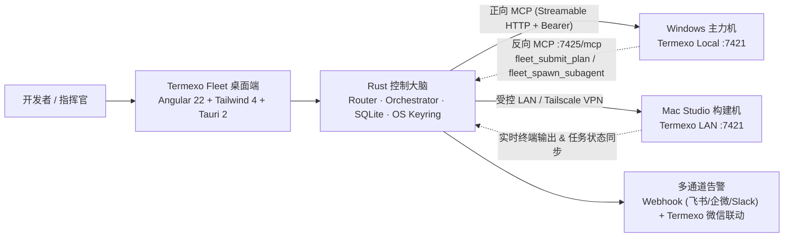
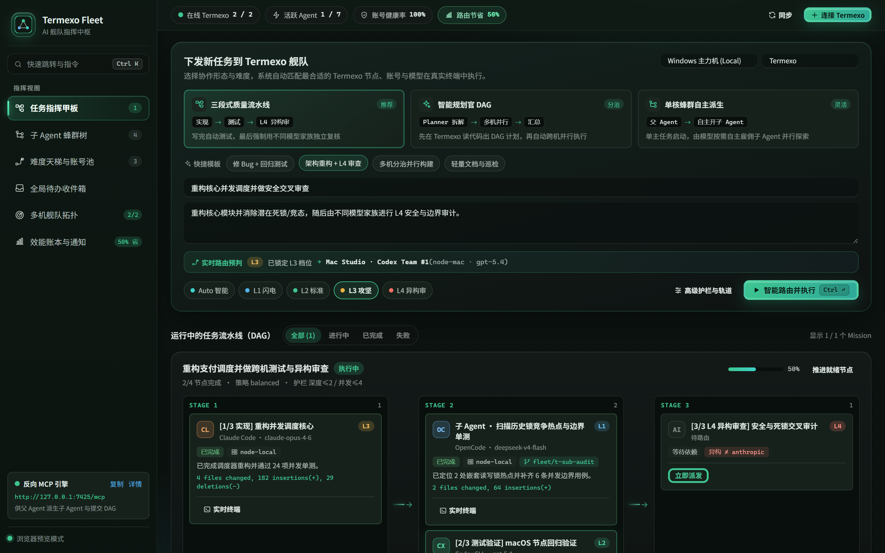
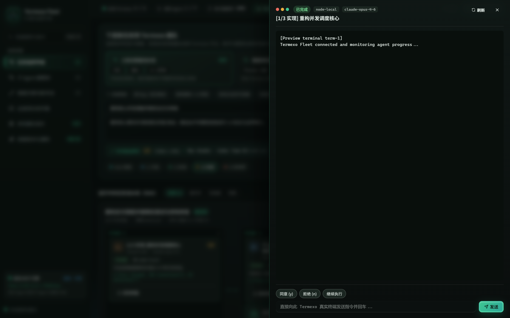
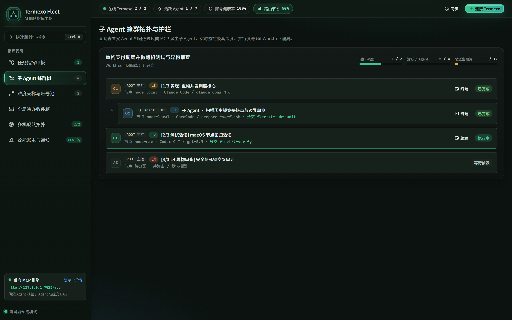
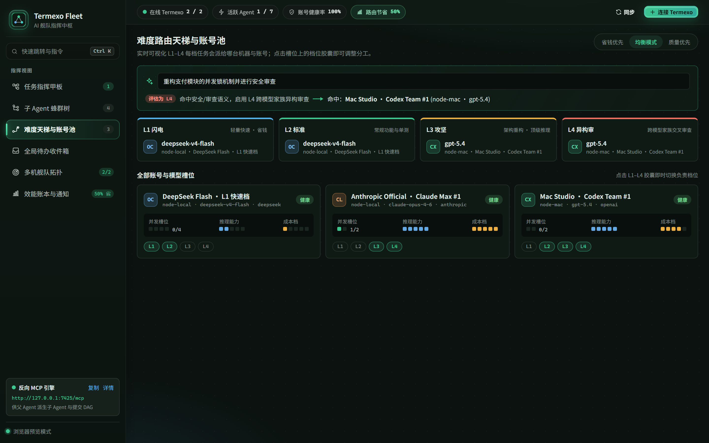
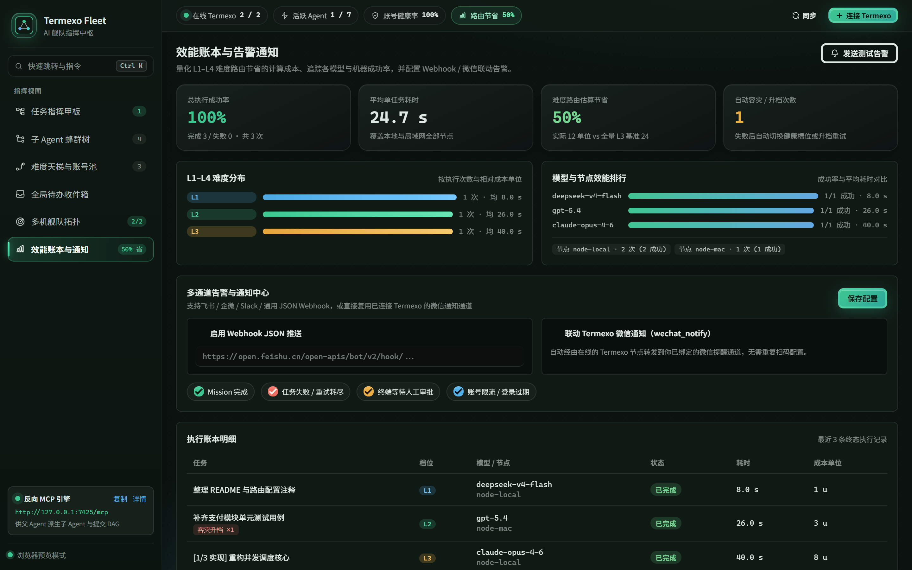
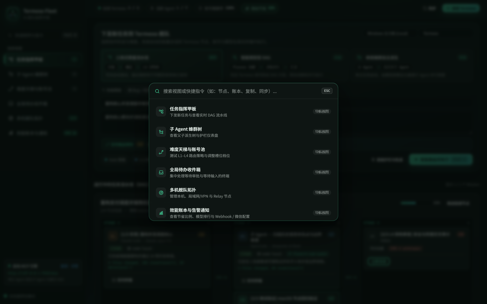

# Termexo Fleet · Preview v0.1 产品与技术预览手册

> **本地优先的 AI 编程舰队指挥中枢** — 基于 [Termexo](https://github.com/gemron/Termexo) MCP 构建，统一调度单台或多台 Termexo 实例，按任务难度（`L1–L4`）智能路由账号与模型，支持父 Agent 在独立 Git Worktree 中自主派生子 Agent，并提供本地效能账本与多通道告警。

---

## 一、核心定位与设计哲学

| 设计原则 | 工程落地说明 |
| --- | --- |
| **零黑盒透明执行** | Fleet 不在后台私自调 API 跑黑盒循环；所有主任务、DAG 节点与子 Agent 均真实运行于 Termexo 的原生 PTY 终端与任务看板中，随时可通过侧滑终端抽屉旁观或直接回复接管。 |
| **L1–L4 难度驱动路由** | 按任务复杂度分级调度：`L1 闪电`（省钱/轻量改动）、`L2 标准`（日常研发与单测）、`L3 攻坚`（架构重构与并发）、`L4 异构审`（强制跨模型家族交叉审查）。 |
| **自主蜂群 + 工程硬护栏** | 内置本地反向 MCP 引擎（`127.0.0.1:7425/mcp`），通过 Termexo 任务级 `mcpProfileIds` 按需挂载；模型可自主提交 DAG 计划或派生子 Agent，并受最大递归深度、最大并发、总派生预算、重复目标去重与 Git Worktree 隔离保护。 |
| **多机算力网与标签亲和** | 同时接入本机、局域网/Tailscale VPN（受控私网 Host 防护 + 可选自签名 TLS）与远程中继 Termexo；连接前可一键探测 RTT 延迟与目标能力，按 `#windows / #macos / #gpu` 标签智能分派。 |
| **自动容灾与效能账本** | 自动识别 `429 限流`、`402 余额不足`、`422 模型异常`、`AuthExpired` 与 `WaitingApproval`，5 分钟槽位冷却 + 跨号跨机故障转移 + 失败自动升档（`L1 → L2 → L3`）；本地 SQLite 量化成本节省并联动飞书 / 企微 / Slack / 微信告警。 |

---

## 二、系统架构与模块划分

| Crate / 目录 | 职责边界 |
| --- | --- |
| `crates/fleet-protocol` | 跨层领域模型：`FleetNode`、`AccountModelSlot`、`Mission`、`MissionTask`、`NodeProbeResult`、`ExecutionRecord`、`FleetAnalytics`、`NotificationSettings` |
| `crates/fleet-connector` | Streamable HTTP Termexo MCP 客户端、能力自动发现与版本兼容降级、`probe()` 探测、`classify_terminal_output` 信号分类、`wechat_notify` 桥接 |
| `crates/fleet-router` | `L1–L4` 难度评估、三档路由评分（`cost`/`balanced`/`quality`）、跨机标签亲和与并发均衡、L4 异构模型家族排除 |
| `crates/fleet-orchestrator` | DAG 拓扑 Kahn 环路校验、阶段分层、上游交接摘要构建、子 Agent 护栏校验、Git Worktree 自动化管理 |
| `crates/fleet-mcp-server` | Axum 反向 MCP 服务（`127.0.0.1:7425/mcp`），强制 Bearer 令牌校验并暴露 7 个编排工具 |
| `src-tauri` | Tauri 2 桌面运行时、SQLite 持久化、OS Keyring 凭据存储、3 秒后台状态同步与多通道告警分发 |
| `apps/desktop-ui` | Angular 22 指挥舱：6 大核心视图、`Ctrl+K` 命令面板、实时路由预判条、右侧滑出式终端抽屉 |

---

## 三、反向 MCP 7 工具契约

| 工具名 | 调用方 | 关键参数 | 护栏与返回 |
| --- | --- | --- | --- |
| `fleet_list_nodes` | Planner / Worker | `parent_token` | 返回在线节点、OS 标签、并发上限与工作区列表 |
| `fleet_submit_plan` | Planner | `parent_token`, `steps[]` | Kahn 环路校验后落盘 DAG 并立即派发首阶段就绪节点 |
| `fleet_spawn_subagent` | 父 Agent | `parent_token`, `title`, `goal`, `difficulty?`, `isolate_worktree?` | 强制深度/并发/总预算/去重护栏，默认创建 `fleet/<id>` 隔离 Worktree |
| `fleet_list_subagents` | 父 Agent | `parent_token` | 返回当前父任务下全部子 Agent 的状态、节点、模型与分支 |
| `fleet_wait_subagents` | 父 Agent | `parent_token`, `subagent_ids[]`, `timeout_secs?` | 阻塞等待子 Agent 终态，返回 `resultSummary` 与 `diffStat` |
| `fleet_message_subagent` | 父 Agent | `parent_token`, `subagent_id`, `message` | 向子 Agent 所在 Termexo 实时 PTY 发送补充指令 |
| `fleet_cancel_subagent` | 父 Agent | `parent_token`, `subagent_id` | 停止远端 Termexo 任务并回收并发槽位 |

---

## 四、界面预览（7 张 2x Retina 实机截图）

### 1. 任务指挥甲板与可视化 DAG 流水线
支持 3 种协作形态卡片、4 套一键快捷模板、输入即见的**实时路由预判条**、`Ctrl+Enter` 极速下发、Mission 状态筛选胶囊与带能量流光连线的多阶段 DAG 看板。

### 2. 右侧滑出式实时终端抽屉
点击任意 DAG 节点或蜂群节点的「实时终端」即可从右侧滑出，支持查看真实 PTY 输出、一键刷新快照与底部快捷回复 / 自定义对话直达终端。

### 3. 子 Agent 蜂群拓扑与护栏仪表盘
直观呈现 `ROOT 主控 → D1/D2 子 Agent` 的嵌套派生树、独立 Git Worktree 分支与实时护栏水位（递归深度、活跃子 Agent、总派生预算）。

### 4. 难度路由天梯与账号健康池
输入一句任务描述即可模拟测试命中结果，实时预览 `L1–L4` 四档胜出槽位，并在下方账号池一键切换各槽位负责档位或手动恢复冷却槽位。

### 5. 多机 Termexo 舰队拓扑
星型控制大脑直连多台 Windows / macOS / Linux Termexo 节点，实时监控并发负载条、工作区/终端数与亲和标签，新建节点支持本机 / 局域网 / Tailscale 预设与连通性探测。

### 6. 效能账本与多通道告警通知
量化 `L1–L4` 路由相对全量 `L3` 基准的成本节省比例、统计成功率与容灾升档次数，并一站式配置飞书 / 企微 / Slack Webhook 与 Termexo 微信联动通知。

### 7. 全局命令面板 (`Ctrl+K`)
全键盘驱动，随时按下 `Ctrl+K` 毫秒级切换 6 大视图、连接新节点、全舰队同步或一键复制反向 MCP JSON。

---

## 五、端到端实测验证记录

- **Rust 全工作区单测与全链路真实 HTTP E2E**：**15/15 通过**（含 `full_phase3_live_http_e2e` 覆盖真实 HTTP 节点探测、反向 MCP 401 鉴权与 `fleet_submit_plan` / `fleet_spawn_subagent`、重复目标护栏拦截、429 冷却与 L1→L2 升档重试、L4 跨模型家族审查、真实 Webhook + `wechat_notify` 推送与 SQLite 账本统计）。
- **本机 Termexo 实机联调**：成功跑通真实 PTY 终端任务派发、3 跳容灾切换（`422 → 402 → OpenCode 2.2s 成功响应`）与实时终端交互闭环。
- **Windows 生产构建**：已通过 `npm run tauri:build` 输出 `NSIS (.exe)` 与 `MSI (.msi)` 双格式安装包并发布于 [v0.1.0-preview.1](https://github.com/gemron/Termexo-Fleet/releases/tag/v0.1.0-preview.1)。
