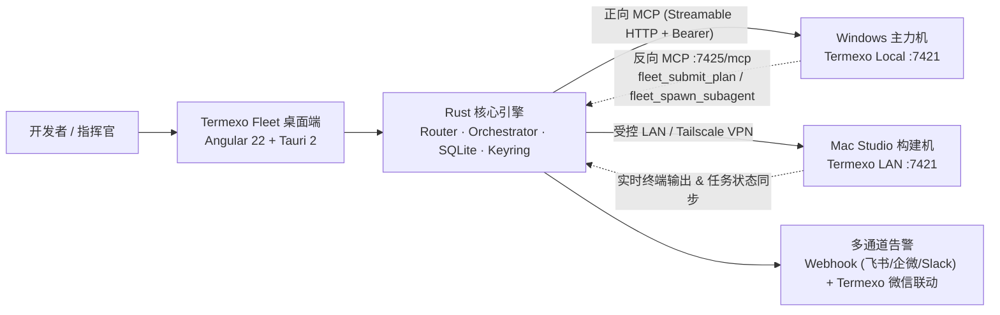
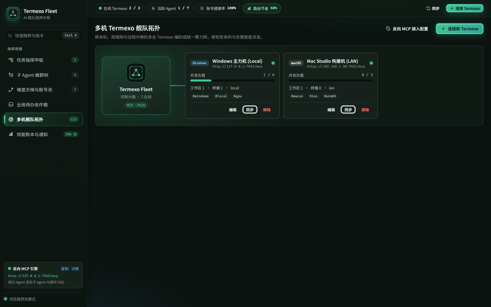

# Termexo Fleet · Preview v0.1 产品预览

> **本地优先的 AI 编程舰队指挥官** — 统一编排单台或多台 **Termexo** 实例，按任务难度自动路由账号与模型，支持父 Agent 自主派生子 Agent，所有执行全程透明落地于 Termexo 真实终端与任务看板，拒绝黑盒。

---

## 一、核心定位与设计哲学

| 设计原则 | 说明 |
| --- | --- |
| **零黑盒执行** | Fleet 本身不私下调 API 跑隐藏循环；每一个主任务、DAG 节点与子 Agent 都真实运行在 Termexo 的终端（PTY）与任务看板中，随时可打开实时终端旁观或接管。 |
| **难度驱动路由（L1–L4）** | 按任务复杂度自动分级：`L1 闪电`（省钱/轻量）、`L2 标准`（日常研发/单测）、`L3 攻坚`（架构重构/并发）、`L4 异构审`（强制跨模型家族交叉审计）。 |
| **自主蜂群 + 工程护栏** | 内置本地反向 MCP 引擎（`:7425/mcp`），通过任务级 `mcpProfileIds` 按需注入；模型可自主提交并行 DAG 计划或雇佣子 Agent，同时受最大深度、最大并发、总派生预算与 Git Worktree 隔离保护。 |
| **多机算力编织** | 同时连接本机（Local）、局域网/Tailscale VPN（受控私网 + 自签名 TLS 选项）与远程中继的多台 Termexo，按 `#windows / #macos / #gpu` 标签亲和与并发余量智能派发。 |
| **透明效能与自动容灾** | 实时探测限流（429）、余额不足（402）、模型异常（422）与登录过期，自动冷却槽位并切换健康账号或升档重试；本地 SQLite 账本量化节省比例并联动 Webhook / 微信通知。 |

---

## 二、系统架构



---

## 三、界面预览（高清实机截图）

### 1. 任务指挥甲板与可视化 DAG 流水线


### 2. 右侧滑出式实时终端抽屉


### 3. 子 Agent 蜂群拓扑与护栏仪表盘


### 4. 难度路由天梯与账号健康池


### 5. 多机 Termexo 舰队拓扑


### 6. 效能账本与多通道告警通知


### 7. 全局命令面板 (`Ctrl+K`)


---

## 四、核心功能与典型场景

### 核心功能
- **多机互联与连通性探测**：本机 / LAN / Tailscale VPN / Relay 预设，实时探测延迟与能力徽章，Token 仅存 OS Keyring。
- **L1–L4 难度感知路由**：`省钱 / 均衡 / 质量` 三档策略、实时路由预判、429/402/422 冷却容灾与自动升档重试、L4 跨模型家族异构审查。
- **自主子 Agent 蜂群与安全护栏**：反向 MCP 7 工具集、深度/并发/预算/去重硬性护栏、自动 Git Worktree 分支隔离。
- **效能账本与多通道通知**：SQLite 执行记录、相对全量 L3 基准节省比例测算、飞书/企微/Slack Webhook 与 Termexo 微信联动。

### 典型使用场景
1. **日常研发智能省钱**：轻量改动走 `L1/L2` 低成本模型，架构与并发攻坚走 `L3`，整体节省 40%–60% 算力成本。
2. **核心代码三段式质量闭环**：实现 → 自动单测验证 → L4 异构模型交叉安全审计。
3. **跨平台多机并行构建**：Windows 主力机与局域网 Mac Studio 协同，按 `#windows / #macos` 标签自动分派并行跑。
4. **长任务无人值守**：Worktree 隔离并行子 Agent，限流自动切号，审批或完工自动推送飞书 / 微信。

---

## 五、快速启动

```bash
npm --prefix apps/desktop-ui install
npm run tauri:dev
```
