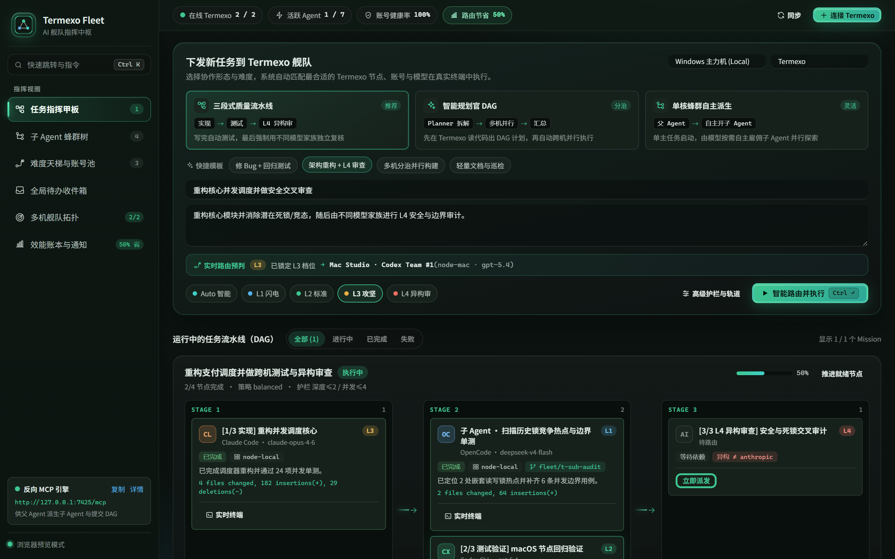

# Termexo Fleet v0.1.1 发布：本地优先的多机 AI 编程舰队指挥中枢

Termexo Fleet v0.1.1 现已发布。Termexo Fleet 是 MIT 开源的本地桌面端多 Agent 调度中枢，用于将本机、局域网或 Tailscale VPN 内的多台 [Termexo](https://github.com/gemron/Termexo) 桌面实例编排成一套“零黑盒”的 AI 编程舰队。

> 维护者声明：本文由 Termexo Fleet 项目维护者提交，使用 AI 辅助整理，内容已对照 v0.1.1 正式发行说明与源码核对。配图与演示视频均基于新版桌面端真实构建采集，示例工作流用于说明功能边界，不代表所有第三方模型与 CLI 在任意环境下的实机联调保证。



## 解决什么问题

当开发者在多台电脑、多个账号上同时运行 Claude Code、Codex CLI、OpenCode、Pi Agent 等编程 Agent 时，通常会遇到四个实际痛点：

1. **额度分配粗放**：改文档、补注释等轻量任务也交给最贵的旗舰推理模型，消耗大量高阶配额。
2. **限流与报错需人工盯守**：遇到 `429` 限流、`402` 余额不足或登录过期时，任务直接停摆。
3. **单一模型自写自审存在盲区**：由同一模型家族编写并审查核心并发或安全逻辑，容易漏掉同源偏好问题。
4. **黑盒编排难以介入**：隐藏在脚本或后台 API 循环里的多 Agent 看不到实时终端状态，卡在审批或异常交互时接管成本高。

## 核心能力（v0.1.1）

- **零黑盒透明执行**：所有父任务与子 Agent 均在真实 Termexo PTY 终端和任务看板中运行。在指挥面板点击任意节点的「实时终端」即可滑出终端抽屉查看实时输出，并通过快捷回复栏（如 `同意 (y)` / `拒绝 (n)`）或命令行直接交互。
- **L1–L4 智能难度天梯与异构交叉审**：支持 `省钱 / 均衡 / 质量` 三档策略与实时路由预判。轻量改动命中低成本快速模型（L1），架构攻坚调度旗舰推理模型（L3）；进入 **L4 安全/合并审查** 时，路由器会自动排除上游作者所使用的模型家族（例如 Claude 实现 → Codex 独立复核）。
- **反向 MCP 自主派生子 Agent 蜂群**：内置本地 Streamable HTTP 反向 MCP 服务（`127.0.0.1:7425/mcp`，OS Keyring Bearer 鉴权），向已连接的父 Agent 暴露 `fleet_submit_plan`、`fleet_spawn_subagent` 等 7 个编排工具。每个子 Agent 自动在独立 Git Worktree 分支隔离执行，并受递归深度、并发槽位与总派生预算护栏约束。
- **多机星型拓扑与自动容灾**：支持按标签亲和调度本机与局域网 / Tailscale 节点（如 Windows 主力机 + Mac Studio 构建机）。实时识别限流与错误信号，自动冷却故障槽位、切换健康账号并在重试时升档。
- **本地 SQLite 效能账本与多通道告警**：全部状态与执行记录落盘在本地 `termexo-fleet.db`，可量化对比难度路由相比全量 L3 的算力节省比例，并支持飞书 / 企业微信 / Slack Webhook 及联动 Termexo 微信通知。

## 跨平台安装与快速体验

v0.1.1 通过 GitHub Actions 提供 Windows x64（EXE/MSI）、macOS（Apple Silicon `aarch64` 与 Intel `x64` DMG）及 Linux x64（AppImage/DEB）安装包，并合入统一 npm 包：

```bash
# Node.js 18.18+ 环境一行启动，自动匹配当前系统架构
npx termexo-fleet@latest
```

### 使用前提与当前边界

- Termexo Fleet 是调度控制面，需配合至少一台运行中的 Termexo 实例使用，各 Agent 自身的 CLI、账号与模型服务需由用户另行准备。
- Windows 安装包目前尚未进行商业代码签名；macOS 采用 ad-hoc 临时签名且未公证，首次启动可能需要在“系统设置 → 隐私与安全性”中允许运行。
- 欢迎开发者试用、提交 Issue 或反馈多机实战场景；如果对你的多 Agent 工作流确有帮助，欢迎前往 GitHub 点亮 Star。

- 正式发行与下载：<https://github.com/gemron/Termexo-Fleet/releases/tag/v0.1.1>
- 项目源码：<https://github.com/gemron/Termexo-Fleet>
- 官网展示与 45 秒演示视频：<https://www.termexo.com/#fleet>
- npm 包：<https://www.npmjs.com/package/termexo-fleet>
