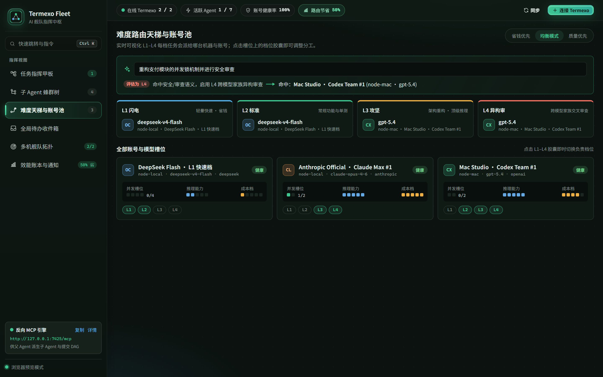
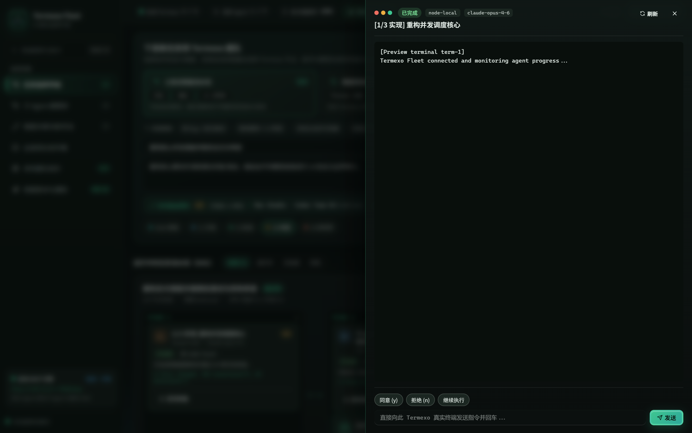
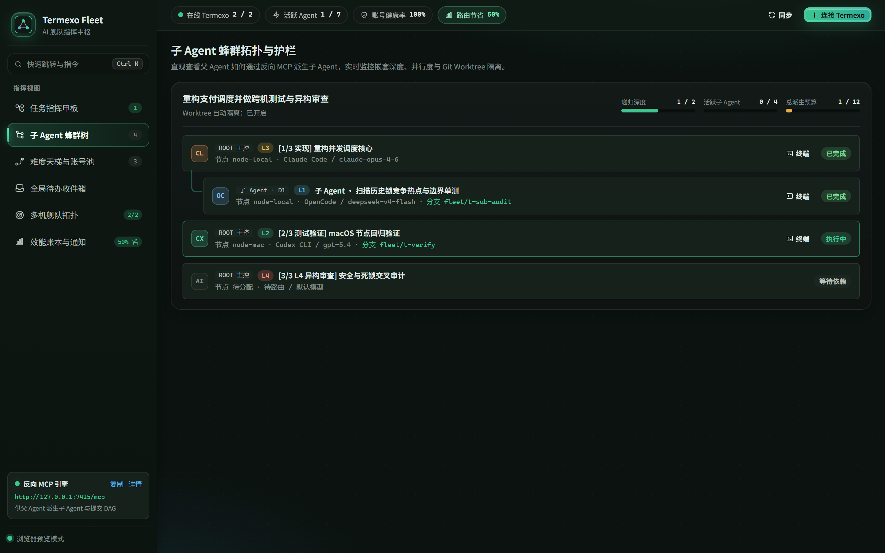

# 多账号、多机器跑 Claude Code / Codex 时，如何做到“既省额度又零黑盒”？

同时用几个编程 Agent 干活久了，很容易遇到四件让人分心的事：改个 README 错别字也烧着最贵的推理模型额度；跑着跑着触发 `429` 限流得自己切号重来；同一个模型自己写并发代码又自己做 Review，死锁照样漏掉；更麻烦的是，市面上很多多 Agent 编排脚本把执行藏在黑盒 API 循环里，一卡在权限确认或异常输出就无从接管。

我是 **Termexo Fleet** 的维护者。本文由 AI 辅助撰写，内容均对照 `v0.1.1` 正式发行版本与 Rust 核心代码核对；文中界面截图来自项目真实构建。示例工作流用于说明设计取舍与使用方式，不替代各平台与各模型 CLI 的实机验收。



## 1. 为什么坚持“零黑盒 PTY”而不是黑盒 API 编排？

很多多 Agent 框架直接调模型 HTTP API 自己在后台循环工具调用。这种方式做 Demo 很顺，但进入真实工程仓库后，两个问题会立刻放大：

- **上下文不可见**：Agent 到底卡在 `cargo test` 编译、等待交互式输入，还是进入了死循环，只看摘要日志很难判断。
- **人工介入成本高**：你想中途补一句约束或者敲一个 `y` 放行工具调用，却没有真实的交互终端可以接管。

Termexo Fleet 把 **执行面** 完整留给 [Termexo](https://github.com/gemron/Termexo) 的真实 PTY 终端，自己只做一层轻量、本地优先的 **Rust 调度控制面**。每个任务和子 Agent 都有可见的真实终端，在指挥台点开「实时终端」抽屉就能直接旁观输出、一键回复或随时中止。



## 2. 用 L1–L4 难度天梯把算力花在刀刃上

不是所有任务都需要最贵的模型。Termexo Fleet 在派发前会对任务做复杂度分级（也可手动锁定），配合 `省钱 / 均衡 / 质量` 策略与 **实时路由预判条**，按下 `Ctrl+Enter` 前就能看到落到哪台机器、哪个账号和模型：

- **L1 闪电（`1u`）**：文档润色、注释、格式化、只读扫描 → 命中低成本高速槽位（如 DeepSeek Flash / Mini / Haiku）。
- **L2 标准（`3u`）**：常规功能开发、修 Bug、单测补齐 → 兼顾速度与节点余量。
- **L3 攻坚（`8u`）**：架构重构、并发死锁排查、数据库迁移 → 分配顶级推理模型（如 Claude Opus / GPT-5.4）。
- **L4 异构交叉审（`8u`）**：安全审计与合并门禁 → **自动排除上游作者使用的模型家族**（例如 Claude 写的实现，强制交给 Codex / OpenAI 家族做独立复核）。

任务结束后，本地 SQLite 效能账本会记录真实耗时与成本单位，并与“全量跑 L3”的基准对比，方便量化路由到底省了多少算力。

## 3. 反向 MCP 自主蜂群：给 Agent 派活，但必须装护栏

如果允许父 Agent 无限嵌套派生子 Agent，很快就会出现“死循环烧 Token + 工作区文件互相踩踏”。

Termexo Fleet 内置本地反向 MCP 服务（`127.0.0.1:7425/mcp`，Bearer Token 存于操作系统 Keyring），把 `fleet_submit_plan` 和 `fleet_spawn_subagent` 暴露给父 Agent 的同时，在控制面强制执行三道护栏：

1. **DAG 环检测**：通过 Kahn 拓扑算法先校验无环，再放行 Stage 1。
2. **独立 Git Worktree 隔离**：每个子 Agent 运行在专属分支和 Worktree，互不污染工作区。
3. **递归深度、并发水位与总预算上限**：同时带重复目标防重锁，避免失控派生。



## 4. 如何本地试用与当前边界

项目完全 MIT 开源、本地优先（无云端锁定），已支持 Windows x64、macOS（Apple Silicon & Intel）与 Linux x64：

```bash
npx termexo-fleet@latest
```

也可以直接从 GitHub Releases 下载原生桌面安装包。几点客观前提提前说明：

- 需要配合本机或局域网/Tailscale 内运行中的 Termexo，以及你已登录的 Agent CLI（如 Claude Code、Codex CLI、OpenCode 等）。
- Windows 安装包目前未做商业签名，macOS 为 ad-hoc 临时签名（首次打开需在隐私与安全性中放行）。
- 多 Agent 并行并不能自动保证代码质量，建议先从单个本地节点、一条简单的三阶段流水线（实现 → 单测 → L4 审查）跑通，再逐步接入多机。

欢迎试用并提 Issue 讨论多机调度与路由策略的改进空间，如果项目对你的研发流程确有帮助，欢迎点个 Star 支持。

- GitHub 源码：<https://github.com/gemron/Termexo-Fleet>
- v0.1.1 下载：<https://github.com/gemron/Termexo-Fleet/releases/tag/v0.1.1>
- 45 秒官网演示：<https://www.termexo.com/#fleet>
