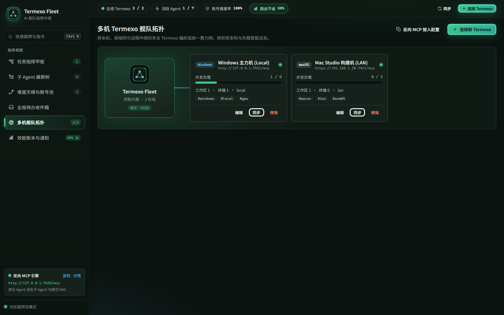

# 用 Rust + Tauri 2 + 反向 MCP 搭建多机 AI 编程调度中枢：Termexo Fleet 工程实践

> 维护者说明：我是 Termexo Fleet 的作者与维护者。本文由 AI 辅助整理，基于 `v0.1.1` 实际 Rust Workspace 代码与前端构建核对。文中所有架构描述对应仓库真实实现，不夸大未实机覆盖的场景。

在同时使用 Claude Code、Codex CLI、OpenCode 等多个本地编程 Agent 时，单机多标签很快会遇到调度瓶颈：如何按难度分配不同模型账号？遇到 `429` 限流如何自动切号重试？Windows 主力机和局域网 Mac 构建机如何协同跑同一条流水线？

为了解决这些问题，我们用 **Rust Workspace + Tauri 2 + Angular 22** 做了 MIT 开源的本地控制面 **Termexo Fleet**（已发布 `v0.1.1`）。本文拆解其中五个核心工程设计。



## 一、Workspace 分层架构：将控制面与执行面解耦

Termexo Fleet 不重新造一套 PTY 终端或黑盒 Agent 运行时，而是通过双向 Streamable HTTP MCP 编排一台或多台 [Termexo](https://github.com/gemron/Termexo) 桌面实例：

```text
Termexo-Fleet/
├── crates/
│   ├── fleet-protocol/      # 领域模型、路由策略、账本与通知协议
│   ├── fleet-connector/     # 正向 Streamable HTTP MCP 客户端、健康探活与终端信号分类器
│   ├── fleet-router/        # L1-L4 难度评估、标签亲和路由、L4 跨模型家族过滤
│   ├── fleet-orchestrator/  # Kahn DAG 校验、护栏水位、上游上下文交接、Git Worktree 隔离
│   └── fleet-mcp-server/    # Axum 反向 MCP Server（127.0.0.1:7425/mcp + Bearer 鉴权）
├── src-tauri/               # Tauri 2 桌面宿主、SQLite 账本、OS Keyring、多通道告警
└── apps/desktop-ui/         # Angular 22 + Tailwind 4 无边框暗色指挥台（6 视图 + Ctrl+K）
```

这样做的好处是：**核心路由与编排逻辑完全独立于 UI 与宿主框架**，所有状态落盘到本地 SQLite（`termexo-fleet.db`），访问令牌全部存入系统 Keyring（Windows Credential Manager / macOS Keychain / Linux Secret Service），不落明文配置。

## 二、L1–L4 难度路由与 L4 异构审查过滤器

在 `fleet-router` 中，每个待派发任务会结合语义特征与策略模式（`cost` / `balanced` / `quality`）映射为四个档位：

| 档位 | 典型场景 | 成本基准 | 路由关键约束 |
| --- | --- | --- | --- |
| `L1` | 文档、注释、格式化、只读检索 | `1u` | 优先命中低成本高速槽位 |
| `L2` | 常规功能开发、Bug 修复、单元测试 | `3u` | 兼顾质量与节点空闲并发 |
| `L3` | 架构重构、并发死锁、关键迁移 | `8u` | 锁定旗舰推理模型槽位 |
| `L4` | 安全审计、合并门禁、高风险 Diff 复核 | `8u` | **强制过滤上游作者模型家族**（如 `!= anthropic`） |

配合前端的「实时路由预判条」和「交互式路由模拟器」，用户在真正执行前即可确认落点节点、账号和档位。

## 三、终端信号分类与自愈容灾

`fleet-connector` 会持续读取目标 Termexo 终端输出并进行轻量分类：

- 识别到 `429 RateLimited`、`402/422 ApiError` 或 `AuthExpired` 时，将故障账号槽位自动打入 5 分钟冷却期，把任务无缝改派到其他健康槽位，并在重试时支持自动升档（`L1 → L2 → L3`）。
- 识别到 `WaitingApproval` 时，不会盲目重试，而是推送到「全局待办收件箱」并触发飞书 / 企微 / Slack / 微信告警，开发者点开滑出式终端抽屉即可直接点 `同意 (y)` 放行。

## 四、反向 MCP 自主蜂群与三层护栏

通过任务级注入本地反向 MCP（`:7425/mcp`），父 Agent 可以主动调用 `fleet_submit_plan` 或 `fleet_spawn_subagent` 拆分并行子任务。为防止递归失控，`fleet-orchestrator` 强制执行：

1. **Kahn 拓扑排序验环**：拒绝任何带环依赖的 DAG 计划。
2. **Git Worktree 隔离**：每个派生子 Agent 自动分配独立分支与工作树，避免并发改同一文件导致冲突。
3. **深度 / 并发 / 预算护栏**：可配 `maxDepth`、`maxConcurrency`、`maxSubagents` 及相同目标防重锁。

## 五、一套 GitHub Actions 打通三端原生安装包 + 统一 npm 分发

参考 Termexo 的发布链路，我们在 CI 中同时编译 Windows x64、macOS（`aarch64` + `x64`）与 Linux x64 原生桌面包，并合入单个 npm 包 `termexo-fleet`：

```bash
npx termexo-fleet@latest
```

启动器根据 `process.platform` 与 `process.arch` 自动解压缓存并拉起对应原生桌面应用（Node.js 18.18+ 即可免配置 Rust 环境直接运行）。

> 当前边界提示：需搭配本机或局域网中的 Termexo 实例及各 Agent 自身的 CLI/账号使用；Windows 安装包尚未商业签名，macOS 为 ad-hoc 临时签名，首次打开可能需在系统隐私设置中允许。

欢迎有兴趣的同学查看 Rust 源码、试用或提交 PR / Issue 交流多 Agent 调度实践；如果对你有启发，欢迎点个 Star。

- 仓库地址：<https://github.com/gemron/Termexo-Fleet>
- v0.1.1 Release：<https://github.com/gemron/Termexo-Fleet/releases/tag/v0.1.1>
- 官网与演示视频：<https://www.termexo.com/#fleet>
