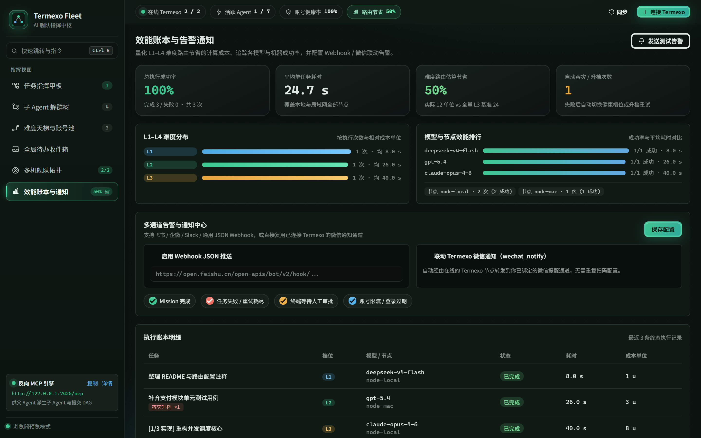

# Termexo Fleet v0.1.1 上手指南：跨平台安装、多机调度与 L1–L4 模型路由配置

> 作者说明：我是 Termexo Fleet 项目维护者。本文由 AI 辅助整理，已依据 v0.1.1 正式发行说明与桌面端构建逐项核对；文中截图均来自项目真实桌面构建。

如果你已经在本机或局域网多台电脑上使用 Claude Code、Codex CLI、OpenCode 等编程 Agent，想要把多个账号和机器统一调度起来，同时保留实时终端可控性，可以试试开源本地桌面应用 **Termexo Fleet**（MIT 协议）。



## 一、安装方式（Windows / macOS / Linux）

### 方式 1：通过 npm 一行启动（推荐，需 Node.js 18.18+）

```bash
npx termexo-fleet@latest
```

同一个 npm 包内已包含三平台二进制入口，会自动识别 Windows x64、macOS（Apple Silicon / Intel）与 Linux x64 并缓存拉起原生桌面程序，无需本地安装 Rust 工具链。

### 方式 2：下载原生桌面安装包

前往 [GitHub Releases v0.1.1](https://github.com/gemron/Termexo-Fleet/releases/tag/v0.1.1) 选择对应平台文件：

- **Windows x64**：EXE（NSIS）或 MSI 安装包（需 Windows 10+ 与 WebView2）
- **macOS Apple Silicon (M 系列)**：`aarch64.dmg`
- **macOS Intel**：`x64.dmg`
- **Linux x64**：`.AppImage` 或 `.deb`

> 签名与权限说明：Windows 安装包当前尚未进行商业代码签名；macOS 采用 ad-hoc 临时签名、尚未公证，首次启动可能需要在“系统设置 → 隐私与安全性”中手动允许。

## 二、5 分钟跑通第一个多阶段任务

### 第 1 步：连接本机或局域网 Termexo 节点

1. 确保本机（或局域网/Tailscale 内另一台机器）已运行 [Termexo](https://github.com/gemron/Termexo) 并开启 MCP 服务（默认端口 `7421`）。
2. 在 Termexo Fleet 顶部点击 **「+ 连接 Termexo」**，填入节点地址与 Access Token（Token 加密存入系统 Keyring）。
3. 可为节点打上标签（例如 `#windows`、`#macos`、`#gpu`），用于后续按平台亲和调度。

### 第 2 步：在「难度天梯与账号池」配置 L1–L4 分工

进入左侧 **「难度天梯与账号池」**（快捷键 `Alt+4`）：

- 给每个已发现的模型账号槽位勾选它承接的难度档位（`L1` 轻量闪电、`L2` 标准开发、`L3` 架构攻坚、`L4` 异构交叉审）。
- 顶部提供 **实时路由模拟器**，点击预设样例或输入一句话，立即预览会被分到哪台机器的哪个模型。

### 第 3 步：在「任务指挥甲板」下发三段式流水线

回到 **「任务指挥甲板」**（`Alt+1`）：

1. 选择「三段式流水线（实现 → 测试验证 → L4 异构审）」，输入需求目标。
2. 观察底部 **实时路由预判条** 确认命中模型后，按 `Ctrl+Enter` 启动。
3. 在下方可视化 DAG 流水线中，点击任意节点的 **「实时终端」** 即可滑出真实 PTY 终端抽屉，随时查看输出或点击 `同意 (y)` 放行审批。

### 第 4 步：查看省费账本与配置告警通知

在 **「效能账本与通知」**（`Alt+6`）中可以查看：

- 任务成功率、平均耗时、容灾切号次数，以及相比全量 L3 模型的估算算力节省比例；
- 飞书 / 企业微信 / Slack / 自定义 JSON Webhook 推送，以及联动在线 Termexo 节点的微信通知转发。

日常使用建议搭配 `Ctrl+K` 打开全局命令面板，快速切换 6 个视图或直达实时终端。

## 三、注意事项

- Termexo Fleet 不内置大模型 API 额度，也不替代各 Agent 自身的 CLI，用户需自行准备并登录所使用的编程 Agent CLI。
- 局域网跨机连接建议配合内网或 Tailscale VPN，并妥善保管 Access Token。

欢迎下载试用并在 GitHub 反馈问题或建议，如果对你的日常开发确实有帮助，欢迎给仓库点个 Star。

- GitHub 源码：<https://github.com/gemron/Termexo-Fleet>
- 安装包下载：<https://github.com/gemron/Termexo-Fleet/releases/tag/v0.1.1>
- 45 秒功能演示：<https://www.termexo.com/#fleet>
