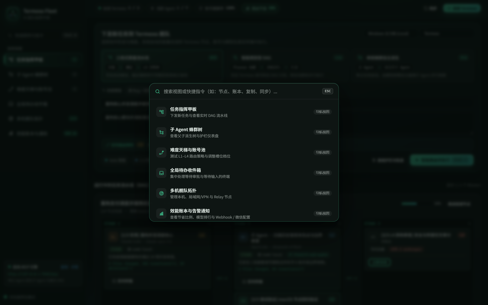

# 为什么多 Agent 编程编排容易失控？我们在 Termexo Fleet 里的 4 个架构取舍

> 说明：我是 Termexo Fleet 维护者。本文由 AI 辅助整理，依据 `v0.1.1` 实际源码与发行文档核对，重点复盘多 Agent 本地编排的设计取舍与边界。

过去几个月，多 Agent 编程编排工具层出不穷，但真正用到日常研发仓库时，很多人会退回到手动开几个终端窗口。原因往往不是“模型不够强”，而是编排层缺少工程可观测性与成本边界。

在构建开源本地调度中枢 **Termexo Fleet**（Rust + Tauri 2 + Angular 22，MIT 协议）的过程中，我们做了 4 个反直觉但非常务实的架构取舍。

## 取舍 1：放弃自建黑盒 Agent Loop，坚持“控制面 + 真实 PTY 执行面”

把工具调用全部藏在后台 API 循环里，看似统一，却丢掉了真实终端里最宝贵的排错信息与人工接管能力。

Termexo Fleet 选择把 [Termexo](https://github.com/gemron/Termexo) 作为透明执行面：所有派发的任务与子 Agent 都在真实 PTY 终端里跑，Fleet 只通过 Streamable HTTP MCP 下发任务、采集信号、调度依赖。一旦需要人工介入，直接在滑出式终端抽屉里就能读取原文并发送输入。

## 取舍 2：路由不是只选“最贵模型”，而是引入 L4 跨模型家族排斥

多数路由逻辑只关心吞吐和价格，但在代码审查场景里，**同源盲区**比价格更致命。

我们在 `fleet-router` 中把难度天梯拆为 `L1–L4`：日常修改尽量落到 `L1/L2` 控制成本，而在 `L4`（安全与边界交叉审）阶段强制记录上游实现节点的 `modelFamily`，选槽时主动排除同家族模型（如 Claude 实现 → Codex 独立审计）。这不是玄学“越贵越好”，而是把成本预算从简单任务转移到高价值复核上。

## 取舍 3：允许父 Agent 自主派生子 Agent，但用硬护栏替代“口头 Prompt 约束”

只靠 System Prompt 叮嘱 Agent “不要无限拆分子任务”在复杂仓库里并不可靠。

Termexo Fleet 通过本地反向 MCP（`127.0.0.1:7425/mcp`）开放 `fleet_submit_plan` 与 `fleet_spawn_subagent`，但所有安全边界都在 Rust 编排器里硬编码校验：

- **Kahn 算法验环**：有环 DAG 直接拒绝，避免死锁等待。
- **Git Worktree 隔离**：派生子 Agent 自动进入独立工作树分支，避免并发写冲突。
- **水位护栏**：强制限制 `maxDepth`、`maxConcurrency`、`maxSubagents` 及重复子目标锁。

## 取舍 4：全量状态本地化与 OS Keyring 凭据隔离

多机、多账号场景涉及大量 Access Token 与代码仓库摘要，上传云端 SaaS 会带来额外的合规与隐私成本。因此 Fleet 的路由策略、DAG 状态、效能账本全部留在本地 SQLite（`termexo-fleet.db`），节点令牌与反向 MCP Bearer Token 统一托管给操作系统原生 Keyring。

## 当前局限与适用边界

这套架构也有明确前提，提前写清楚避免误解：

1. **强依赖真实执行节点**：至少需要一台运行中的 Termexo，且各 Agent CLI 与账号需自行配置。
2. **安装包签名仍在推进**：Windows 安装包目前未商业签名，macOS 为 ad-hoc 临时签名（首次运行需在系统隐私设置中放行）。
3. **复杂跨机任务仍需人工把关**：自动容灾（`429/402` 冷却切号）能减少人工盯屏，但关键代码合并前依然建议查看 Diff 与单测结果。

支持 Windows x64 / macOS（Apple Silicon & Intel）/ Linux x64，Node.js 18.18+ 可直接运行 `npx termexo-fleet@latest` 体验。欢迎在 GitHub 讨论多 Agent 编排的工程边界与改进建议。

- 仓库源码：<https://github.com/gemron/Termexo-Fleet>
- v0.1.1 发行说明：<https://github.com/gemron/Termexo-Fleet/releases/tag/v0.1.1>
- 官网展示：<https://www.termexo.com/#fleet>
