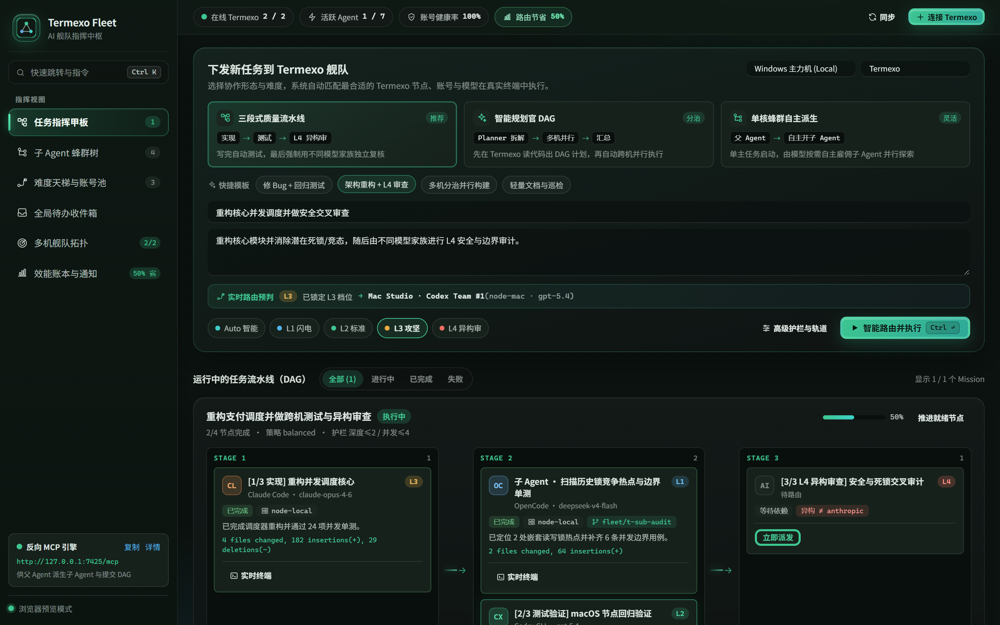
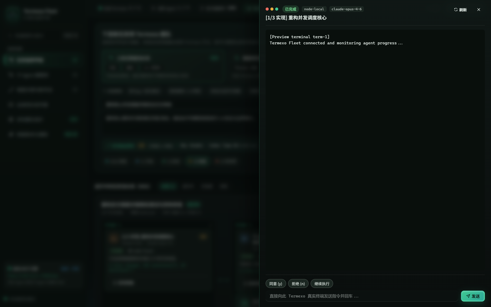
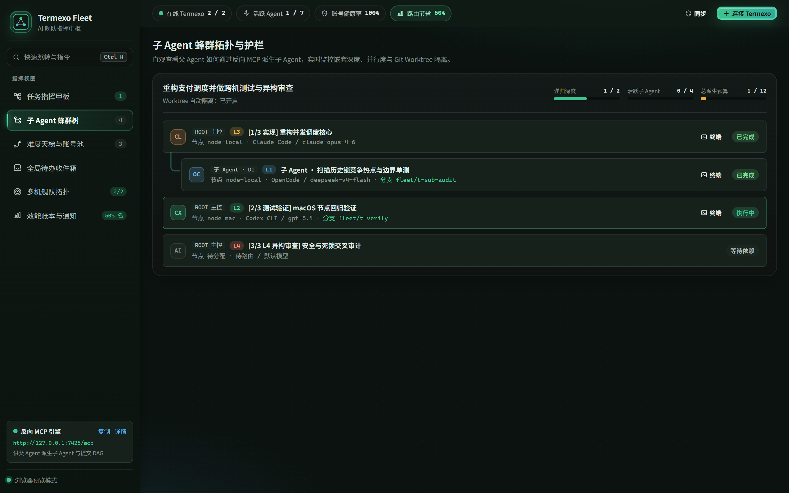

# Orchestrating Multi-Machine Coding Agents Without a Black Box: Inside Termexo Fleet v0.1.1

*Maintainer note: I maintain Termexo Fleet. This article was written with AI assistance and verified directly against the v0.1.1 Rust workspace, Angular UI, and release notes. All screenshots are captured from the real desktop build. This post is published free without a paywall.*



If you run multiple coding agents — Claude Code, Codex CLI, OpenCode, or Pi Agent — across more than one account or machine, manual window juggling stops scaling quickly.

Sending documentation tweaks to flagship reasoning models drains top-tier quota. Hitting a `429` rate limit stalls an unattended run until you switch accounts by hand. Letting the same model family both write and review concurrent code leaves systematic blind spots. And most multi-agent frameworks hide execution behind headless API loops, stripping away the live terminal visibility you actually need when a run pauses for approval.

**Termexo Fleet v0.1.1** (MIT open-source, built with Rust, Tauri 2, and Angular 22) takes a different approach: keep real PTY terminals as the transparent execution plane and add a local-first orchestration control plane on top.

## 1. Zero Black-Box Execution

Instead of re-implementing an opaque agent loop, Termexo Fleet connects over Streamable HTTP MCP to one or more [Termexo](https://github.com/gemron/Termexo) desktop instances — on your local machine, over LAN, or across Tailscale VPN.

Every mission node and spawned sub-agent runs inside a visible Termexo terminal. From the Fleet dashboard, opening the slide-over **Live Terminal Drawer** shows raw PTY output and lets you send quick approvals (`y`, `n`, continue) or arbitrary commands directly to the running agent.



## 2. L1–L4 Difficulty Routing & Cross-Family L4 Audits

Before you dispatch a task (`Ctrl+Enter`), Fleet's **Live Route Forecast** evaluates complexity across four tiers (`L1` Flash, `L2` Standard, `L3` Deep, `L4` Cross-Review) under `cost`, `balanced`, or `quality` policy:

- **`L1` (1u)** handles comments, docs, formatting, and read-only scans on low-cost fast slots.
- **`L2` (3u)** handles routine feature work, bug fixes, and test suites.
- **`L3` (8u)** reserves flagship reasoning slots for architecture refactors and concurrency fixes.
- **`L4` (8u)** enforces **cross-family review**: Fleet tracks the upstream author's `modelFamily` and excludes that family when selecting a reviewer (e.g., Claude implementation → Codex security review).

When terminal output signals `429 RateLimited`, `402/422 ApiError`, or `AuthExpired`, Fleet places the affected slot into a 5-minute cooldown and re-routes the task to a healthy slot, escalating tier on retry when needed.

## 3. Reverse MCP Sub-Agent Swarms with Hard Guardrails

Termexo Fleet runs a local reverse MCP endpoint (`127.0.0.1:7425/mcp`) authenticated by a Bearer token stored in your OS Keyring. Parent agents receive 7 orchestration tools (`fleet_submit_plan`, `fleet_spawn_subagent`, `fleet_wait_subagents`, etc.), bounded by Rust-enforced guardrails rather than prompt suggestions:

- **Kahn's algorithm acyclicity validation** before any DAG plan dispatches Stage 1.
- **Automatic Git Worktree isolation** so parallel child agents never trample the same working tree.
- **Hard caps** on recursion depth (`maxDepth`), active child concurrency (`maxConcurrency`), total sub-agent budget (`maxSubagents`), and duplicate-goal locks.



## 4. Local SQLite Ledger & Cross-Platform Single-Command Launch

All routing policies, execution history, and estimated savings vs. all-`L3` baselines live locally in `termexo-fleet.db`. Multi-channel alerts support Feishu, WeCom, Slack, custom JSON webhooks, and bridged Termexo WeChat notifications.

v0.1.1 ships Windows x64, macOS (Apple Silicon & Intel), and Linux x64 builds both as native installers on GitHub Releases and bundled inside a single npm launcher (Node.js 18.18+):

```bash
npx termexo-fleet@latest
```

### Practical Prerequisites & Current Limitations

- Termexo Fleet is a control plane: you still need at least one running Termexo instance plus your own agent CLIs, model accounts, and API/subscription access.
- Windows installers are currently unsigned, and macOS builds use ad-hoc signing without notarization (first launch may require approval in Privacy & Security).
- Automated failover and cross-family audits reduce manual baby-sitting, but human diff and test verification remain essential before merging critical code.

Source code, installers, and the 45-second tour are open under the MIT license:

- GitHub: <https://github.com/gemron/Termexo-Fleet>
- Release v0.1.1: <https://github.com/gemron/Termexo-Fleet/releases/tag/v0.1.1>
- Product Showcase: <https://www.termexo.com/#fleet>
